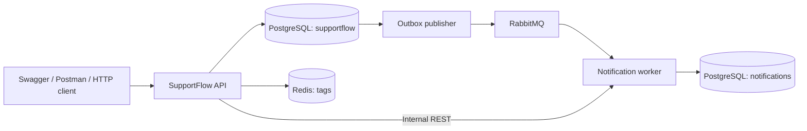

# SupportFlow

Система обработки обращений клиентов: REST API на Java 21 и отдельный Java-сервис уведомлений.

[](https://github.com/I-F-E-N-I-X-I/supportflow/actions/workflows/ci.yml)

**Spring Boot · JPA/Hibernate · PostgreSQL · JWT · RabbitMQ · Redis · Flyway · OpenAPI · JUnit 5 · Mockito · Testcontainers · Gradle · Docker Compose**

Клиент создаёт обращение, сотрудник берёт его в работу, отвечает и отмечает решение. Изменения статуса попадают в историю и в асинхронный inbox клиента. При недоступности брокера обращение сохраняется, а доставка повторяется после восстановления.

## Возможности

- Роли CLIENT, SUPPORT и ADMIN; регистрация, BCrypt и JWT с ограниченным сроком действия.
- Обращения со статусами NEW → IN_PROGRESS → RESOLVED → CLOSED, повторное открытие RESOLVED.
- Назначение сотрудника, приоритеты, теги, редактирование с проверкой версии.
- Публичные и внутренние комментарии; внутренние доступны только сотрудникам.
- Поиск по названию, фильтры по статусу/приоритету/сотруднику, сортировка и пагинация.
- История статусов и отчёты по количеству, времени до решения и загрузке сотрудников.
- Демонстрационное поле компенсации BigDecimal: учёт суммы, без перевода денег или платёжной интеграции.
- Идемпотентное создание обращений, transactional outbox, publisher confirms, повторы доставки и dead-letter queue.
- Redis-кэш справочника тегов с TTL, инвалидацией и fallback на PostgreSQL.
- Собственный сервис уведомлений с отдельной базой и защищённым внутренним REST API.

## Запуск одной командой

Нужен работающий Docker Engine с Docker Compose v2. Рекомендуется выделить Docker не менее 4 ГБ памяти. Локальная Java для контейнерного запуска не нужна.

**Windows PowerShell:**

```powershell
.\scripts\init-env.ps1
docker compose up --build -d
```

**Linux/macOS:**

```bash
sh scripts/init-env.sh
docker compose up --build -d
```

Скрипт создаёт `.env` со случайными секретами и не перезаписывает существующий файл. `.env` исключён из Git. В нём значение `ADMIN_PASSWORD` — пароль пользователя `admin`. Первоначальный запуск скачивает образы и собирает два приложения, поэтому может занять несколько минут.

- **Swagger UI:** [http://localhost:8080/swagger-ui/index.html](http://localhost:8080/swagger-ui/index.html)
- **OpenAPI JSON:** [http://localhost:8080/v3/api-docs](http://localhost:8080/v3/api-docs)
- **Готовность API:** [http://localhost:8080/actuator/health/readiness](http://localhost:8080/actuator/health/readiness)

В Swagger зарегистрируйте пользователя через `POST /api/v1/auth/register`, выполните login, скопируйте `accessToken` и нажмите **Authorize**. Публичная регистрация всегда создаёт CLIENT. Войдите как admin, чтобы назначить зарегистрированному аккаунту роль SUPPORT. Внутренние права проверяются по базе на каждом запросе, поэтому повышение/понижение роли не требует перевыпуска JWT.

Остановка с сохранением данных: `docker compose down`. Журналы: `docker compose logs -f api worker`. Команда `docker compose down -v` удаляет данные и предназначена только для очистки тестового окружения.

## Полный демонстрационный сценарий

После запуска стека, при наличии Python 3:

```bash
python scripts/smoke.py
```

Сценарий создаёт тестовых клиентов и сотрудника, проверяет JWT, права, идемпотентность, статусы, внутренние комментарии и доставку уведомлений. Секреты и токены не печатаются. Каждое выполнение добавляет новые демонстрационные записи.

Для проверки устойчивости **в локальном тестовом стеке**:

```bash
python scripts/smoke.py --resilience
```

Этот режим поочерёдно останавливает Redis, RabbitMQ и worker, проверяет поведение API и запускает зависимости обратно. Не запускайте его против чужого или рабочего окружения.

## Сборка и тесты

Нужен JDK 21. Wrapper загружает Gradle 8.14.3.

```bash
./gradlew test
./gradlew :api:integrationTest :worker:integrationTest
./gradlew :api:bootJar :worker:bootJar
```

В Windows замените `./gradlew` на `.\gradlew.bat`. Интеграционные тесты **требуют Docker** и поднимают реальные PostgreSQL, RabbitMQ и Redis через Testcontainers. Они не подменяются H2 и не пропускаются автоматически при недоступности Docker. Модульные тесты работают без контейнеров.

GitHub Actions выполняет две независимые проверки: JUnit/Testcontainers и полный Docker Compose с HTTP-сценарием и сбоями зависимостей. HTML-отчёты доступны в артефакте `test-reports`.

## Структура

```text
api/             REST API, Spring Security, JPA, SQL, Redis и outbox
worker/          RabbitMQ consumer, идемпотентный inbox, внутренний REST API
learning-lab/    Проверяемые упражнения по Java, алгоритмам и многопоточности
infra/           Создание отдельной базы worker
scripts/         Генерация конфигурации и сквозные проверки
postman/         Коллекция запросов без секретов
docs/            Архитектура, API, эксплуатация, SQL и карта требований
```



## Документация

- [Архитектура и гарантии](docs/ARCHITECTURE.md)
- [REST API и правила доступа](docs/API.md)
- [Эксплуатация и устранение неполадок](docs/OPERATIONS.md)
- [Все темы из исходного списка и где их изучать](docs/REQUIREMENTS.md)
- [SQL-практика](docs/sql-exercises.sql)
- [Postman collection](postman/SupportFlow.postman_collection.json)

Это учебный pet-проект. Реальные ограничения и дальнейшие задачи описаны в документации. Kafka не добавлена: из предложенных альтернатив выбран RabbitMQ. Maven использован в предыдущем ReserveHub; здесь сборкой управляет Gradle.
