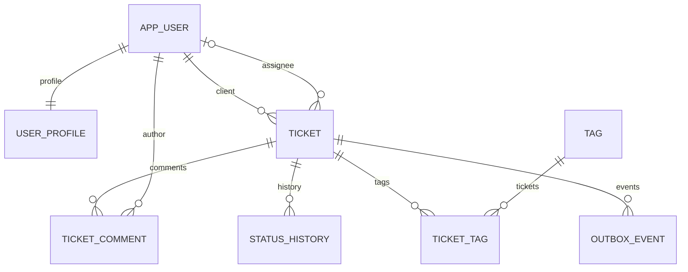
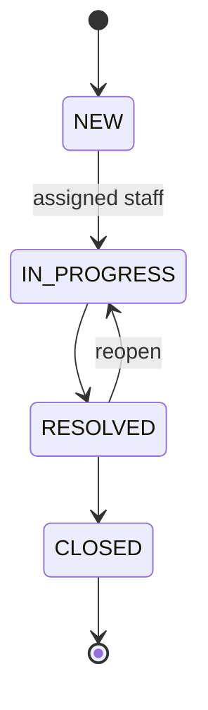

# Архитектура и гарантии

## Границы сервисов

API — многослойный модульный монолит: `identity`, `ticket`, `report`, `event`, `notification`. Контроллеры принимают DTO, сервисы проверяют права и правила, репозитории сохраняют сущности. Worker — отдельный Spring Boot-процесс, потребляющий события RabbitMQ. У него собственные миграции и база notifications. В Compose обе базы находятся в одном PostgreSQL-кластере для экономии ресурсов; сервисы не читают таблицы друг друга.

JPA: Account/UserProfile демонстрируют One-to-One через общий ключ; Ticket/Comment — One-to-Many и Many-to-One; Ticket/Tag — Many-to-Many через join table. Поля сущностей закрыты, DTO не сериализуют Hibernate-прокси. `open-in-view=false` ограничивает persistence context сервисными транзакциями.

## Правила доступа и статусов

CLIENT видит только свои обращения и может закрыть своё RESOLVED-обращение. SUPPORT видит общую очередь, назначает обращения себе, меняет статус назначенных ему обращений. ADMIN может назначать любого сотрудника, менять роли CLIENT/SUPPORT, работать с любым обращением и задавать компенсацию. Роль ADMIN создаётся bootstrap-механизмом; API не позволяет её выдать или снять.

В CLOSED нельзя писать комментарии или менять назначение. Редактирование текста, приоритета и тегов доступно только в NEW. Компенсация — отдельная административная запись, она не выполняет платёж. Внутренние комментарии исключаются SQL/JPQL-запросом для клиента. Чужое обращение возвращает 404, а запрещённое действие над доступным ресурсом — 403.

## Транзакции, конкуренция и идемпотентность

Статусы и назначения меняются с блокировкой строки `PESSIMISTIC_WRITE`. При одновременных переходах второй запрос читает уже обновлённый статус. Поле `@Version` позволяет отклонить PUT из устаревшей формы.

Создание требует `Idempotency-Key`. На время транзакции блокируется строка владельца, затем выполняется поиск по `(client_id, request_key)`. Повтор того же тела возвращает исходное обращение; другое тело с тем же ключом — 409. Fingerprint использует SHA-256 и канонический порядок тегов. Создания разных пользователей не блокируют друг друга. Ключи не истекают автоматически: они сохраняются вместе с обращением.

Ticket, история и outbox сохраняются в одной PostgreSQL-транзакции. Это использует ACID: атомарность операций, целостность через ограничения, изоляцию через блокировки и долговечность подтверждённого commit. Обращения не удаляются через API, чтобы не терять аудит.

## Доставка событий

1. Scheduler выбирает до 10 ожидающих outbox-записей с `FOR UPDATE SKIP LOCKED`.
2. Publisher посылает persistent JSON-сообщение в durable exchange/queue с mandatory routing.
3. Запись помечается опубликованной только после положительного publisher confirm и отсутствия returned message.
4. При ошибке хранится число попыток и время следующей попытки: задержка растёт до 256 секунд. Запись остаётся для дальнейшей доставки.
5. Worker сохраняет уведомление в своей транзакции. Уникальный event_id и `ON CONFLICT DO NOTHING` устраняют дубли. Повторное использование event_id с другим владельцем, ticket_id или статусом отклоняется.
6. Listener подтверждает сообщение после успешного возврата из транзакционного сервиса. После трёх неудач сообщение маршрутизируется в DLQ.

Гарантия — **at-least-once delivery с идемпотентным эффектом**, а не exactly-once transport. Падение после broker confirm, но до commit outbox, может вызвать повтор. Событие содержит только технические идентификаторы, статус и время; тексты обращений и пароли в брокер не попадают. Inbox показывает журнал событий, а не авторитетное текущее состояние: при повторах и нескольких publishers порядок доставки может отличаться от порядка изменений. Текущее состояние хранит API.

## Кэш и HTTP-взаимодействие

Redis содержит только справочник тегов, TTL 30 секунд. После commit создания/удаления тега ключ инвалидируется. Недоступность Redis превращается в cache miss; данные читаются из PostgreSQL. Между параллельным чтением и инвалидацией возможна краткая устарелость до TTL — допустимая для справочника. Список чужих обращений и права не кэшируются.

API получает inbox через REST-клиент worker с connect timeout 2 секунды, read timeout 3 секунды и двумя попытками только для сетевых/серверных ошибок. Внутренний endpoint защищён отдельным токеном и не опубликован на хосте. При сбое worker endpoint уведомлений возвращает 503, а обращения продолжают работать.

## JPA, N+1 и запросы

Связи используют LAZY. DTO списка обращений читает идентификаторы прокси, а не загружает коллекции комментариев и тегов для каждой строки. Теги и комментарии вынесены в отдельные endpoints; комментарии пагинируются в базе. Не следует добавлять в список `getTags()`/`getComments()` без изменения стратегии загрузки: это создаст N+1. Для требуемых связанных данных стоит применять fetch join/entity graph или DTO projection; collection fetch join вместе с пагинацией требует особой осторожности.

`findByUsername` и `findByClientIdAndRequestKey` — derived queries. `@Query` используется для блокировки и ограничения видимости комментариев. Criteria Specification строит фильтры с параметрами и экранированием LIKE. Отчёты используют явный SQL с JOIN, GROUP BY, HAVING, COUNT, SUM и AVG. Индексы покрывают владельца и основные фильтры; подстрочный поиск по названию для больших данных потребует pg_trgm и проверки EXPLAIN ANALYZE.

## Ограничения эксплуатации

Это не готовая банковская система: нет MFA, refresh tokens, password reset, rate limiting, вложений, email/SMS и production HA. JWT живёт 15 минут, logout на сервере не реализован; удаление токена у клиента не отзывает уже выданный JWT. Права читаются из базы при каждом запросе. TLS должен завершаться на внешнем reverse proxy; Compose слушает только localhost. PostgreSQL и RabbitMQ используют persistent volumes, Redis намеренно не хранит критичные данные. Масштабирование bootstrap нескольких API-инстансов требует миграционного/операторского создания администратора вместо текущего startup seed.
